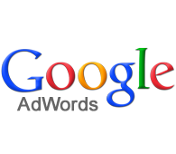
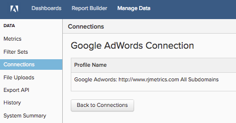

# Connexion [!DNL Google Adwords]

>[!NOTE]
>
>Nécessite des [autorisations d’administrateur](../../../administrator/user-management/user-management.md).

Logo 

Vous avez fait vos recherches, vous avez créé vos publicités, vous avez lancé votre campagne [!DNL Google]. Il est maintenant temps d&#39;analyser vos données sur les dépenses publicitaires et de voir si votre argent est dépensé efficacement. À l’aide de vos données de dépenses publicitaires, vous pouvez [mesurer le retour sur investissement de la campagne en associant votre coût publicitaire et la valeur client à vie (CLV)](../../analysis/roi-ad-camp.md) des utilisateurs acquis à partir de vos campagnes.

Commencez par saisir vos informations d’identification [!DNL Google Adwords] dans [!DNL Commerce Intelligence].

1. Accédez à la page `Connections` sous **Gérer les données > Intégrations**.
1. Cliquez sur **Ajouter une intégration**, en haut à droite de l’écran.
1. Cliquez sur l’icône **[!DNL Google Adwords]** . La page des informations d’identification de [!DNL Google Adwords] s’ouvre.
1. Saisissez vos informations d’identification [!DNL Google Analytics]. Une fois le processus d’autorisation terminé, vous êtes redirigé vers [!DNL Commerce Intelligence].
1. Une liste des identifiants de profil s’affiche. Vérifiez les profils auxquels vous souhaitez vous connecter [!DNL Commerce Intelligence].

   Boîte de dialogue de connexion à 

1. Les modifications sont enregistrées automatiquement. Cliquez donc sur **[!UICONTROL Back to Connections]** lorsque vous avez terminé.

Si vous disposez de plusieurs profils et que vous avez besoin d’aide pour identifier lequel, reportez-vous à la section `Connecting Multiple Google Analytics profiles` ci-dessous.

## Connexion de plusieurs profils [!DNL Google Analytics]

Plusieurs sites web peuvent être connectés à un seul compte [!DNL Google Analytics], identifié par son propre identifiant de profil [!DNL Google Analytics]. Dans ce cas, vous avez la possibilité d’inclure tous vos identifiants de profil dans [!DNL Commerce Intelligence]. Vérifiez les identifiants de profil que vous souhaitez inclure lors de l’étape de sélection du profil.

**Pour identifier l’identifiant de profil Google Analytics d’un site web particulier, procédez comme suit**

1. Connexion à [!DNL Google Analytics]
1. Accéder au tableau de bord de [!DNL Google Analytics] du site web spécifique
1. Examinez l’URL : l’identifiant de profil correspond aux huit numéros `p` à la fin de la ligne :

   `www.google.com/analytics/web/#home/a11345062w43527078p**XXXXXXXX**`

## Déconnexion de [!DNL Google Adwords]

1. Consultez votre page [!DNL Google] [paramètres du compte](https://www.google.com/account/about/?hl=en).
1. Dans la section `Security` , cliquez sur **[!UICONTROL edit]** en regard de `Authorizing` applications et sites.
1. Cliquez sur **[!UICONTROL revoke access]**.

## Connexe

* [Réauthentification des intégrations](https://experienceleague.adobe.com/fr/docs/commerce-knowledge-base/kb/how-to/mbi-reauthenticating-integrations)
* [Suivre la source de référence de commande via  [!DNL Google ECommerce]](../integrations/google-ecommerce.md)
* [Suivre la source de référence des utilisateurs dans votre base de données](../../analysis/google-track-user-acq.md)
* [Découvrez vos sources et canaux d’acquisition les plus précieux.](../../analysis/most-value-source-channel.md)
* [Augmenter le retour sur investissement de vos campagnes publicitaires](../../analysis/roi-ad-camp.md)
* [Comment fonctionne  [!DNL Google Analytics] ’attribution UTM ?](../../analysis/utm-attributes.md)
