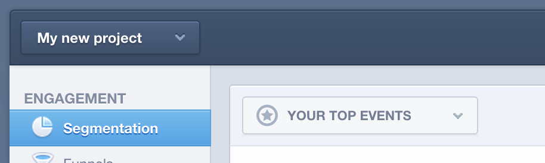
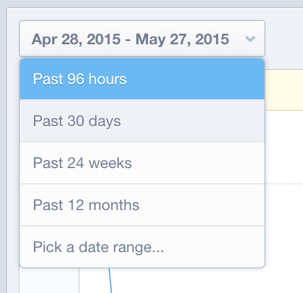
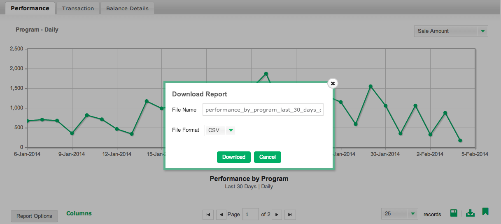

# Validation des données dans [!DNL Mixpanel]

Lorsque [!DNL Adobe Commerce Intelligence] se connecte pour la première fois à vos données [!DNL Mixpanel], votre gestionnaire de compte ou votre analyste peut vous demander de fournir des exportations de données à partir de [!DNL Mixpanel] à des fins de validation. Vous pouvez ainsi confirmer que vous avez synchronisé toutes les données qui sont disponibles pour vous directement dans [!DNL Mixpanel].

## Processus d’exportation des données : `Events`

1. Consultez votre section `Segmentation` et affichez les `Your Top Events`.

   

1. Sélectionnez `Past 96 Hours` pour la période

   

1. Faites défiler jusqu’à la partie inférieure droite du rapport et exportez un fichier `.csv` :

   

1. Envoyez le fichier `.csv` au gestionnaire de compte ou à l’analyste avec lequel vous travaillez sur ce processus de validation.

