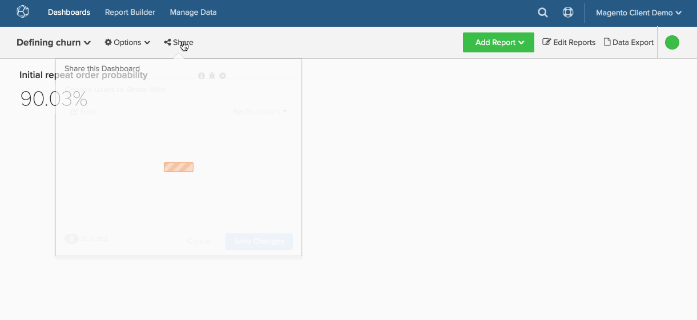

# Partage de tableaux de bord à l’échelle de l’organisation

Il est facile de s’assurer que chaque utilisateur a accès aux tableaux de bord professionnels essentiels dans [!DNL Adobe Commerce Intelligence]. Le partage universel de tableaux de bord facilite une collaboration et une transparence accrues dans l’ensemble de votre organisation en fournissant une « source de vérité » unique.

1. Pour présenter vos informations à vos collègues, cliquez sur **[!UICONTROL Share this Dashboard]** dans la partie supérieure de l’écran.

1. La liste des utilisateurs s’affiche. Le tout premier utilisateur de la liste sera votre organisation. Cochez la case en regard de son nom.

1. Définissez le niveau de `Permissions` que vous souhaitez offrir aux autres utilisateurs (`View`, `Edit` ou `None`).

1. Cliquez sur **[!UICONTROL Save Changes]**.

   Si `Permissions` avez été défini sur `View` ou `Edit` et que les utilisateurs recherchent votre tableau de bord, celui-ci s’affichera dans les résultats de la recherche.

Exemple :

<!--{: width="675" height="311"}-->
